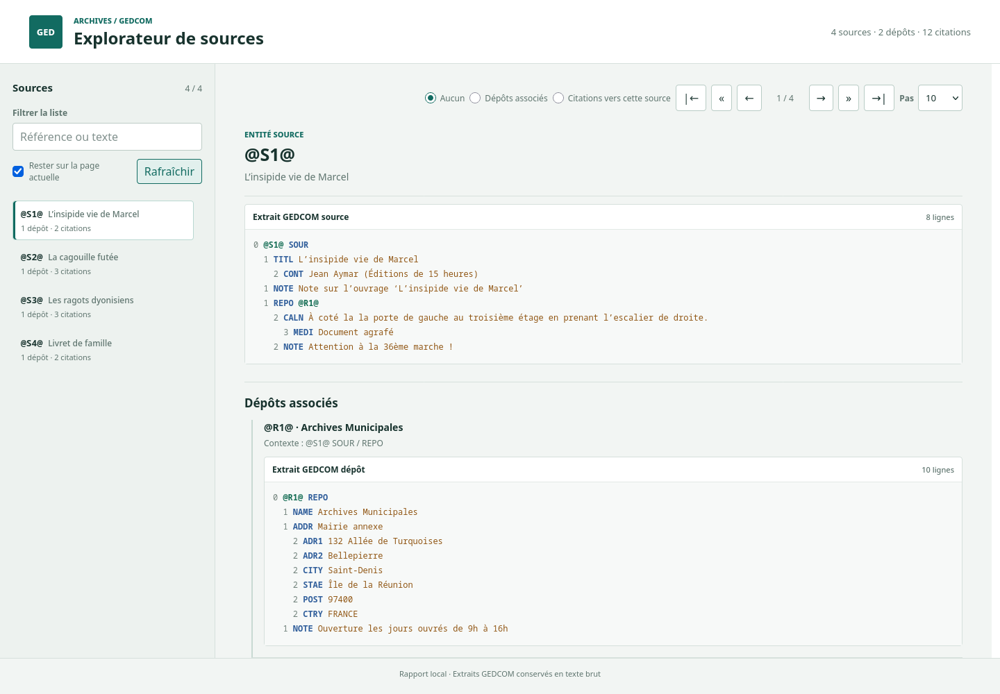

# GEDCOM Source Explorer

Analyseur GEDCOM écrit en C pour extraire les sources, citations et dépôts, avec génération d’un rapport HTML statique consultable dans un navigateur.

## Objectif du projet

Ce projet analyse un fichier GEDCOM pour distinguer deux cas de `SOUR` :

- les entités de source, qui sont des enregistrements de niveau 0 : `0 @S1@ SOUR`
- les citations de source, qui sont des références de niveau > 0 : `1 SOUR @S1@`, `2 SOUR Texte libre`, etc.

Le but est volontairement limité :

- lire un fichier GEDCOM ligne par ligne,
- conserver les sous-arbres GEDCOM complets des sources, citations et dépôts,
- ignorer correctement le bloc d’en-tête `0 HEAD` et les BOM UTF-8 éventuels,
- distinguer les sources de niveau 0 des citations de niveau > 0,
- extraire les enregistrements de dépôt `REPO` avec leur identifiant et leur nom,
- garder le contexte du parent courant (`INDI`, `FAM`, `NOTE`, ...),
- stocker les résultats dans une liste dynamique,
- afficher les résultats dans le terminal ou les présenter dans un rapport HTML local,
- parcourir, filtrer et consulter les sources, dépôts associés et citations depuis le rapport.

Ce projet est utile pour comprendre :

- la lecture de fichiers texte,
- le parsing simple de fichiers structurés,
- la gestion mémoire dynamique en C,
- la création de tests unitaires,
- la séparation d’un projet C entre API, implémentation et tests.

---

## Structure du projet

```text
.
├── build/                            # binaires générés par le Makefile
│   ├── gedcom_parser
│   ├── test_parser
│   ├── test_gedcom_context
│   ├── test_source_list
│   ├── test_string_utils
│   ├── test_repository_list
│   ├── test_html_report
│   ├── test_source_order
│   ├── report/                       # généré par make report
│   │   ├── index.html
│   │   ├── report.css
│   │   └── report.js
│   ├── browser-test/                 # généré par make test-browser
│   └── dist/                         # distribution de make dist
├── include/
│   ├── gedcom_context.h             # API de construction du contexte GEDCOM
│   ├── gedcom_excerpt.h             # tampon dynamique pour les extraits GEDCOM
│   ├── html_report.h                # API de génération du rapport HTML
│   ├── gedcom_parser.h              # API du parseur
│   ├── report_data.h                # modèle des données du rapport
│   ├── repository_list.h            # modèle et API des dépôts
│   ├── source_order.h               # comparaison numérique des références
│   ├── source_list.h                # modèle et API de la collection de sources
│   └── string_utils.h               # utilitaires de chaînes
├── src/
│   ├── gedcom_context.c             # formatage du contexte des citations
│   ├── gedcom_excerpt.c             # accumulation des lignes d’un extrait
│   ├── html_report.c                 # sérialisation du rapport HTML
│   ├── gedcom_parser.c              # lecture et interprétation GEDCOM
│   ├── main.c                       # point d’entrée CLI et affichage
│   ├── report_data.c                # préparation des données JSON du rapport
│   ├── repository_list.c            # stockage dynamique des dépôts
│   ├── source_order.c               # tri des références source
│   ├── source_list.c                # stockage dynamique des sources
│   └── string_utils.c               # implémentation des utilitaires de chaînes
├── tests/
│   ├── test_gedcom_context.c        # tests du formatage du contexte
│   ├── test_html_report.c           # test de sérialisation sûre du rapport
│   ├── test_parser.c                # tests d’intégration du parseur
│   ├── test_repository_list.c       # tests de la collection de dépôts
│   ├── test_source_order.c           # tests du tri numérique des références
│   ├── test_source_list.c           # tests de la collection de sources
│   ├── test_string_utils.c          # tests des utilitaires de chaînes
│   └── browser/
│       └── report.spec.js            # tests Playwright du rapport
├── web/
│   ├── report.html                  # template HTML statique
│   ├── report.css                   # présentation du rapport
│   ├── report-desktop.png           # capture desktop (1440 x 1000)
│   ├── report-mobile.png            # capture mobile (390 x 844)
│   └── report.js                    # navigation et coloration GEDCOM
├── .gitignore
├── .nvmrc                             # version Node.js recommandée
├── Makefile
├── scripts/
│   └── setup-browser-tests.sh          # installation des dépendances Playwright
├── DIST_README.md                    # guide de la distribution binaire
├── package.json                     # dépendance Playwright pour les tests navigateur
├── package-lock.json                # versions résolues des dépendances npm
├── playwright.config.js             # configuration du serveur et de Chromium
├── README.md
├── gedcom-test.ged                  # fichier GEDCOM d’exemple
└── ...
```

---

## Prérequis

Le cœur du projet est écrit en C et ne dépend d'aucune bibliothèque externe :
la bibliothèque standard C fournit les fonctions système et de gestion des
chaînes utilisées par l'analyseur.

- **Compilateur C**, GCC recommandé : compile et lie l'analyseur ainsi que les
  tests unitaires.
- **GNU Make** : orchestre la compilation et expose les commandes `make` du
  projet.
- **tar** : nécessaire pour créer ou extraire l’archive `make dist`.
- **Navigateur web** : ouvre le rapport HTML généré; aucun serveur n'est requis
  pour consulter le rapport normal.

Les outils suivants ne sont nécessaires que pour les commandes correspondantes :

- **Python 3** : sert le rapport sur une adresse locale pendant les tests
  navigateur.
- **Node.js 22 ou supérieur et npm 10 ou supérieur** : installent et exécutent
  Playwright, qui pilote Chromium pour tester les interactions du rapport
  (`make test-browser`) uniquement. Node.js 24 LTS est recommandé; `.nvmrc`
  indique cette version aux gestionnaires compatibles.
- **clang-format**, **clang-tidy** et **cppcheck** : formatent ou analysent le
  code avec `make format`, `make lint` et `make cppcheck`.

Vérification rapide :

```bash
gcc --version
make --version
```

---

## Démarrage rapide

### 1. Compiler le projet

```bash
make
```

Cela produit le binaire :

```bash
./build/gedcom_parser
```

### 2. Exécuter l’analyseur en ligne de commande

Le lancement direct sans argument affiche l’aide et n’analyse aucun fichier :

```bash
./build/gedcom_parser --help
```

En revanche, `make run` analyse le fixture `gedcom-test.ged` par défaut. Pour
choisir un autre fichier avec Make :

```bash
make run GEDCOM=mon_fichier.ged
```

Avec un fichier GEDCOM personnalisé :

```bash
./build/gedcom_parser mon_fichier.ged
```

### 3. Générer le rapport HTML

Avec le fichier d’exemple :

```bash
make report
```

Avec un fichier GEDCOM personnalisé :

```bash
make report GEDCOM=mon_fichier.ged
```

Le rapport est généré dans `build/report/index.html`. Il peut être ouvert directement dans un navigateur, sans serveur local.

Dans le rapport, les boutons radio « Aucun », « Dépôts associés » et « Citations vers cette source » choisissent une seule destination de défilement automatique. La barre de navigation reste visible pendant le défilement, et la section choisie s’aligne sous celle-ci, même lorsqu’elle ne contient aucun élément.

### 4. Lancer les tests

```bash
make test
```

Les tests C n'ont pas besoin de Node.js ni de npm. Pour préparer les tests
navigateur sous Fedora (y compris Fedora 44), lance :

```bash
make setup-browser-tests
```

Cette cible lance `scripts/setup-browser-tests.sh`. Le script installe uniquement
les dépendances des tests navigateur : Python 3, les
bibliothèques système de Chromium, Node.js/npm si une version compatible n'est
pas déjà disponible, puis Playwright et Chromium. Il peut demander le mot de
passe `sudo` et nécessite une connexion Internet. Les outils C restent à
installer séparément selon les prérequis généraux. Si Node.js vient d'être
installé par nvm, recharge-le dans le terminal courant avec la commande affichée
par le script avant de lancer les tests.

Lancer ensuite les tests d'interface :

```bash
make test-browser
```

Pour exécuter les suites C avec AddressSanitizer et UndefinedBehaviorSanitizer :

```bash
make test-sanitize
```

Cette cible compile des binaires distincts dans `build/sanitize/` et nécessite
un compilateur prenant en charge ces sanitizers. Elle ne remplace pas les
binaires normaux de `make test`.

Pour une installation manuelle, Node.js inclut npm; installe Node.js 22 ou
ultérieur et npm 10 ou ultérieur, puis exécute `npm ci` et
`npx playwright install chromium`. Le script automatise cette préparation sur
Fedora; il ne modifie pas l'installation Node.js existante si elle respecte les
versions minimales.

La cible génère un rapport de test isolé dans `build/browser-test/` à partir de
`gedcom-test.ged`, quelle que soit la valeur `GEDCOM` utilisée pour les autres
cibles; elle ne remplace pas le rapport normal de `make report`.

### 5. Construire et installer une distribution

```bash
make dist
```

La cible produit une archive autonome sous `build/dist/`, suffixée par le système
et l’architecture de compilation. Elle contient le binaire, le GEDCOM d’exemple,
les ressources HTML/CSS/JavaScript et un guide d’utilisation. Pour l’installer
dans un dossier utilisateur :

```bash
mkdir -p "$HOME/Applications/gedcom-source-explorer"
tar -xzf build/dist/gedcom-source-explorer-*.tar.gz \
  -C "$HOME/Applications/gedcom-source-explorer" --strip-components=1
cd "$HOME/Applications/gedcom-source-explorer"
./gedcom-source-explorer
```

L’archive est compilée pour le système et l’architecture de la machine qui lance
`make dist`. Conserver son arborescence et exécuter le binaire depuis sa racine
permet de retrouver le template et les fichiers web via leurs chemins relatifs.

### 6. Formater et analyser le code

```bash
make format
make lint
make cppcheck
```

`make format` reformate les fichiers C, les en-têtes et les tests. `make lint`
exécute clang-tidy sur les sources et les tests; la règle relative aux conversions
multi-niveaux de `void *` est exclue car ces conversions sont permises en C.
`make cppcheck` exécute les contrôles warning, style, performance et portabilité.
Les exécutables et les familles de contrôles peuvent être remplacés, par exemple
avec `make lint CLANG_TIDY=clang-tidy-18` ou
`make cppcheck CPPCHECK_CHECKS=warning,style`.

### 7. Nettoyer le projet

```bash
make clean
make clean-browser
make clean-all
```

`make clean` supprime les artefacts C et le dossier `build/`. `make clean-browser`
supprime les dépendances npm et les résultats Playwright. `make clean-all` exécute
les deux nettoyages; `package-lock.json` est conservé. Ces commandes ne
désinstallent pas Node.js, npm ou nvm et ne suppriment pas le cache Chromium de
Playwright, généralement stocké dans `~/.cache/ms-playwright`.

---

## Rôle des fichiers principaux

### src/main.c

Le point d’entrée du programme.

Il :

- choisit le fichier GEDCOM à analyser,
- initialise la structure de données,
- appelle `parse_gedcom_with_error` et affiche la ligne et la catégorie en cas
  d'échec,
- affiche les résultats en mode terminal ou génère le rapport HTML,
- libère la mémoire avant de terminer.

### include/gedcom_parser.h

Le contrat public du parseur. Il déclare `parse_gedcom`, l'interface simple, et
`parse_gedcom_with_error`, qui fournit un code d'erreur et un numéro de ligne.
Il inclut les modèles des listes de sources et de dépôts.

### include/html_report.h et src/html_report.c

Ils sérialisent les résultats déjà extraits en rapport HTML statique. Les données
sont échappées en JSON avant insertion au marqueur `{{GEDCOM_REPORT_DATA}}` du
template `web/report.html` ; le module ne reparcourt pas le fichier GEDCOM et ne
contient pas le squelette de la page.

### include/source_list.h et src/source_list.c

Ils définissent et gèrent les données extraites : `Source`, `SourceList`, l’ajout
d’une source à partir d’une structure `SourceInput`, l’initialisation et la
libération de la liste.

### include/repository_list.h et src/repository_list.c

Ils définissent et gèrent les dépôts GEDCOM : leur référence `@R…@`, leur nom,
l’ajout dans une liste dynamique et la libération de la mémoire. Ils conservent
aussi les liens entre une entité source et ses dépôts, avec le contexte GEDCOM.

### include/gedcom_excerpt.h et src/gedcom_excerpt.c

Ils gèrent le tampon dynamique des lignes GEDCOM capturées. Ils ne décident pas
quelles lignes appartiennent à quel enregistrement et ne produisent aucun affichage.

### include/gedcom_context.h et src/gedcom_context.c

Ils construisent la chaîne de contexte d’une citation à partir de l’identifiant,
du type d’enregistrement et du tag GEDCOM au niveau parent direct. Le parseur
retrouve ce parent en suivant les niveaux GEDCOM; il ne confond pas le tag parent
avec un tag frère précédent.

### include/string_utils.h et src/string_utils.c

Ils regroupent les opérations génériques sur les chaînes, notamment la duplication,
le nettoyage des espaces, l’affectation avec copie et le retrait du BOM UTF-8.

### web/report.css et web/report.js

Le CSS adapte la page aux écrans desktop et mobiles. Le JavaScript trie les
références par lettre puis par suffixe numérique, filtre la liste sans tenir
compte de la casse ni des accents, et colore la syntaxe GEDCOM sans interpréter
les extraits comme du HTML. Les URL `http://` et `https://` des extraits sont
cliquables et s’ouvrent dans un nouvel onglet. Le filtre porte sur la référence,
le titre et la description. La fiche présente l’extrait de la source, ses dépôts
associés et les citations qui la référencent ; les citations sans source
correspondante sont signalées séparément. Les boutons radio du rapport règlent
le défilement automatique vers les dépôts associés ou les citations d’une source.

La barre de navigation permet d’aller au premier ou au dernier résultat, de
parcourir les sources une par une ou par sauts de 10, 20, 30, 40 ou 50 résultats.
La position affichée et les déplacements utilisent la liste filtrée. Les touches
fléchées gauche et droite parcourent aussi les sources, hors des champs de saisie.
La case « Rester sur la page actuelle » mémorise facultativement la source choisie
dans le navigateur ; « Rafraîchir » recharge le rapport. Sur mobile, la liste des
sources défile horizontalement. Si le navigateur interdit l'accès à `localStorage`,
la navigation reste disponible mais la source choisie n'est pas mémorisée.

### include/source_order.h et src/source_order.c

Ils comparent les références GEDCOM par lettre puis par suffixe numérique. Ainsi,
`@S2@` précède `@S10@`, même si l’ordre d’apparition dans le fichier est différent.
Le tri ne modifie pas l’ordre d’extraction des données.

### src/gedcom_parser.c

Implémentation du parseur.

Il :

- ouvre le fichier,
- lit chaque ligne,
- supprime un éventuel BOM UTF-8 en tête de ligne,
- ignore le bloc d’en-tête GEDCOM (`0 HEAD` et ses sous-éléments),
- vérifie que les niveaux numériques sont valides et compris entre 0 et 99,
- vérifie les tags GEDCOM `SOUR` et `REPO`,
- distingue entre entité source et citation,
- extrait le titre des entités source depuis `1 TITL`,
- extrait les dépôts `0 @R…@ REPO`, leur nom et les liens `1 REPO @R…@` des sources,
- associe les citations `SOUR @S…@` à leur entité source,
- conserve chaque ligne de l’enregistrement et de ses sous-niveaux dans son extrait,
- récupère le texte associé ou la référence `@Sx@`,
- conserve le contexte du parent courant,
- délègue la construction du contexte et le stockage à leurs modules respectifs,
- retourne un code de succès ou d’erreur.

### tests/

Chaque module C dispose de sa propre suite compilée en exécutable séparé.
`make test` lance les sept suites C :

- `test_parser.c` vérifie l’extraction GEDCOM complète, le filtrage du header, la gestion
  des erreurs, le comportement sur un fichier vide et la distinction entre
  entités et citations, le contexte parent dans les niveaux imbriqués, les
  diagnostics de niveau invalide, les erreurs de lecture et les erreurs
  d'allocation simulées. Le test de lecture est spécifique à Linux et est ignoré
  si le système ne permet pas de provoquer cette erreur de façon fiable.
- `test_gedcom_context.c` vérifie les principaux formats de contexte.
- `test_source_list.c` vérifie l’initialisation, l’ajout, la croissance dynamique
  et la libération de la collection, les métadonnées stockées, le rejet des
  arguments invalides et le nettoyage après échec de copie simulé.
- `test_repository_list.c` vérifie le stockage des dépôts et des liens source-dépôt.
- `test_html_report.c` vérifie l’échappement des données GEDCOM, les commandes de
  navigation et les options de saut de 10 à 50.
- `test_source_order.c` vérifie le tri numérique, les lettres, les zéros initiaux
  et les grands suffixes sans débordement.
- `test_string_utils.c` vérifie la duplication, le nettoyage, l’affectation et le
  retrait du BOM UTF-8.

La suite navigateur `browser/report.spec.js` est séparée : `make test-browser`
la lance dans Chromium. Elle vérifie la navigation, le filtre sans accents, le
rendu des dépôts et citations, ainsi que le fonctionnement lorsque `localStorage`
est bloqué.

---

## Exemple de flux de travail

### Exemple de fichier GEDCOM

```gedcom
0 HEAD
1 GEDC
2 VERS 5.5.1
0 @S1@ SOUR
1 REPO @R1@
1 TITL Source principale
2 CONT Première partie du titre
0 @I1@ INDI
1 SOUR @S1@
2 PAGE Page 12
0 @R1@ REPO
1 NAME Archives Municipales
1 ADDR Mairie annexe
2 CITY Saint-Denis
0 TRLR
```

### Sortie attendue

```text
Analyseur GEDCOM - Extraction des Sources (SOUR)
Analyse du fichier spécifié: 'mon_fichier.ged'
--- Analyse terminée | entités source : 1 | dépôts : 1 | citations : 1
SOURCES ET ÉLÉMENTS ASSOCIÉS
Source  1 | ref=@S1@ | valeur=@S1@
  Extrait GEDCOM source :
    0 @S1@ SOUR
      1 REPO @R1@
      1 TITL Source principale
        2 CONT Première partie du titre
  Dépôt | ref=@R1@ | nom=Archives Municipales | contexte=@S1@ SOUR / REPO
    Extrait GEDCOM dépôt :
      0 @R1@ REPO
        1 NAME Archives Municipales
        1 ADDR Mairie annexe
          2 CITY Saint-Denis
  Citation | ref=@S1@ | contexte=@I1@ INDI
    Extrait GEDCOM citation :
      1 SOUR @S1@
        2 PAGE Page 12
```

---

## API du projet

### Structures

```c
typedef struct {
  char *text;
  size_t length;
  size_t capacity;
} GedcomExcerpt;

typedef struct {
    char *description;
    char *reference;
    char *kind;
    char *context;
    char *title;
    GedcomExcerpt gedcom;
} Source;

typedef struct {
  const char *description;
  const char *reference;
  const char *kind;
  const char *context;
} SourceInput;

typedef struct {
    Source *sources;
    size_t count;
    size_t capacity;
} SourceList;

typedef struct {
    char *reference;
    char *name;
    GedcomExcerpt gedcom;
} Repository;

typedef struct {
    char *source_reference;
    char *repository_reference;
    char *context;
} RepositoryLink;

typedef struct {
    Repository *repositories;
    size_t count;
    size_t capacity;
    RepositoryLink *links;
    size_t link_count;
    size_t link_capacity;
} RepositoryList;

```

`kind` vaut `"entity"` pour une entité source ou `"citation"` pour une citation.
`context` contient `"entity"` pour une entité source et le chemin de contexte
GEDCOM pour une citation.
`Repository` conserve la référence `@R…@` et le nom du dépôt.
`RepositoryLink` relie une source à un dépôt et conserve le contexte de la ligne
`REPO` qui porte cette relation.
`GedcomExcerpt` contient les lignes de l’enregistrement jusqu’à la fin de son
sous-arbre GEDCOM.

### Gestion de la collection

```c
void init_source_list(SourceList *list);
int source_list_add(SourceList *list, const SourceInput *input);
int source_list_set_title(SourceList *list, const char *reference, const char *title);
void free_source_list(SourceList *list);

void init_repository_list(RepositoryList *list);
int repository_list_add(RepositoryList *list, const char *reference, const char *name);
int repository_list_set_name(RepositoryList *list, const char *reference, const char *name);
int repository_list_add_link(RepositoryList *list,
                             const char *source_reference,
                             const char *repository_reference,
                             const char *context);
void free_repository_list(RepositoryList *list);

void gedcom_excerpt_init(GedcomExcerpt *excerpt);
int gedcom_excerpt_append_line(GedcomExcerpt *excerpt, const char *line);
void gedcom_excerpt_free(GedcomExcerpt *excerpt);
```

### Fonction du parseur

```c
int parse_gedcom(const char *filename, SourceList *sources, RepositoryList *repositories);

typedef enum {
    GEDCOM_PARSE_ERROR_NONE,
    GEDCOM_PARSE_ERROR_INVALID_ARGUMENT,
    GEDCOM_PARSE_ERROR_OPEN,
    GEDCOM_PARSE_ERROR_INVALID_LEVEL,
    GEDCOM_PARSE_ERROR_READ,
    GEDCOM_PARSE_ERROR_MEMORY
} GedcomParseErrorCode;

typedef struct {
    GedcomParseErrorCode code;
    size_t line_number;
} GedcomParseError;

int parse_gedcom_with_error(const char *filename,
                            SourceList *sources,
                            RepositoryList *repositories,
                            GedcomParseError *error);
```

`parse_gedcom` conserve son interface simple. `parse_gedcom_with_error` remplit
`GedcomParseError` pour distinguer les erreurs d'argument, d'ouverture, de
niveau GEDCOM, de lecture et d'allocation. `line_number` indique la ligne
concernée lorsqu'elle est connue; il vaut zéro lorsqu'aucune ligne ne peut être
associée à l'erreur, notamment pour l'ouverture ou la fermeture du fichier.

### Génération du rapport HTML

```c
int write_html_report(const char *template_filename,
                      const char *output_filename,
                      const SourceList *sources,
                      const RepositoryList *repositories);
```

Le renderer copie le template et remplace exactement une occurrence de
`{{GEDCOM_REPORT_DATA}}` par les données JSON échappées.

### Signification des codes de retour

- `0` : succès
- `-1` : arguments invalides, erreur d’ouverture ou de lecture, niveau GEDCOM
  numérique invalide ou hors plage, ou échec d’allocation d’un résultat, d’un
  extrait ou du tampon de lecture. Avec `parse_gedcom_with_error`, le champ
  `code` précise la catégorie et `line_number` indique la ligne fautive lorsqu'elle
  est connue. La CLI affiche ces informations sur la sortie d'erreur (`stderr`).

---

## Comment cela fonctionne

Le parseur est volontairement simple et robuste pour un cas pédagogique.

Étapes :

1. ouverture du fichier en lecture,
2. lecture ligne par ligne,
3. suppression d’un éventuel BOM UTF-8 en tête de ligne,
4. nettoyage des caractères de fin de ligne,
5. vérification du format GEDCOM attendu,
6. détection d’un tag `SOUR` en position valide,
7. distinction entre entité source et citation,
8. extraction de la valeur ou de la référence qui suit le tag,
9. association des citations aux sources et des dépôts aux entités source,
10. capture des lignes des blocs jusqu’à leur frontière de niveau GEDCOM,
11. ajout des résultats dans leurs listes respectives,
12. fermeture du fichier et libération mémoire.

### Règle métier clé

Le parseur ne détecte pas simplement le mot `SOUR` n’importe où dans le texte ; il vérifie la structure GEDCOM complete.

Les règles sont les suivantes :

- `0 @S1@ SOUR` → entité source
- `1 SOUR @S1@` → citation dont le parent direct est l’enregistrement de niveau 0
- `2 SOUR Texte libre` → citation dont le parent direct est le tag de niveau 1
  (par exemple `1 BIRT / 2 SOUR` donne le contexte `@I1@ INDI / BIRT`)
- `0 @R1@ REPO` → dépôt et nom associé dans `1 NAME`
- `1 REPO @R1@` dans un enregistrement `SOUR` → lien vers un dépôt
- les références des entités source sont présentées par lettre puis par numéro croissant (`@S2@` avant `@S10@`),
- une entité source ou un dépôt de niveau 0 conserve ses lignes jusqu’au prochain niveau 0,
- une citation de niveau `n` conserve ses lignes jusqu’au prochain niveau inférieur ou égal à `n`,
- `0 HEAD` → en-tête GEDCOM, ignoré
- `0 TRLR` → fin du fichier, ignoré

Cela évite les faux positifs comme :

```gedcom
1 NOTE SOUR can appear in plain text
```

La ligne ci-dessus ne doit pas être confondue avec un vrai tag `SOUR` de structure GEDCOM.

---

## Makefile : commandes utiles

```bash
make          # compile le binaire principal
make run      # analyse gedcom-test.ged
make run GEDCOM=mon_fichier.ged  # analyse le fichier précisé
make report GEDCOM=gedcom-test.ged  # génère le rapport HTML statique
make test     # compile et exécute les tests
make test-browser # exécute les tests Playwright du rapport dans Chromium
make dist     # crée une archive binaire pour l'OS et l'architecture courants
make format   # reformate les fichiers C, en-têtes et tests
make lint     # analyse clang-tidy les sources et les tests
make cppcheck # analyse warning, style, performance et portabilité
make clean    # supprime les artefacts de compilation
make clean-browser # supprime node_modules et les résultats Playwright
make clean-all # effectue les deux nettoyages
```

`make report` valorise le template `web/report.html` en y insérant le JSON des
données, puis place le résultat dans `build/report/index.html`. Les fichiers CSS
et JS sont copiés à côté ; le rapport s’ouvre directement dans un navigateur,
sans serveur local.

### Reproduire les captures

Après avoir généré le rapport, Firefox peut produire les captures headless sans
interface graphique :

```bash
make report GEDCOM=gedcom-test.ged
REPORT_URL="file://$(realpath build/report/index.html)"
CAPTURE_DIR="$(mktemp -d)"
```

Chaque capture utilise son propre profil temporaire pour éviter les conflits avec
une instance de Firefox déjà ouverte :

```bash
mkdir -p "$CAPTURE_DIR/desktop-profile" "$CAPTURE_DIR/mobile-profile"
firefox --headless --no-remote --profile "$CAPTURE_DIR/desktop-profile" --screenshot "$CAPTURE_DIR/report-desktop.png" --window-size 1440,1000 "$REPORT_URL"
firefox --headless --no-remote --profile "$CAPTURE_DIR/mobile-profile" --screenshot "$CAPTURE_DIR/report-mobile.png" --window-size 390,844 "$REPORT_URL"
cp "$CAPTURE_DIR/report-desktop.png" web/report-desktop.png
cp "$CAPTURE_DIR/report-mobile.png" web/report-mobile.png
```

Les captures utilisent `gedcom-test.ged` afin de rester reproductibles et de ne
pas exposer un fichier GEDCOM personnel. Elles illustrent l’interface actuelle ;
les nombres visibles correspondent au fichier d’exemple, pas nécessairement au
rapport généré avec vos propres données. Les captures sont enregistrées dans
`web/` et intégrées ci-dessous. Le répertoire temporaire reste disponible sous
`$CAPTURE_DIR` si les captures sources doivent être conservées.




---

## Tests

Les tests sont séparés par responsabilité dans le répertoire `tests/`. `make test`
compile puis exécute sept binaires indépendants :

- `build/test_parser`
- `build/test_gedcom_context`
- `build/test_source_list`
- `build/test_string_utils`
- `build/test_repository_list`
- `build/test_html_report`
- `build/test_source_order`

Pour exécuter toutes les suites :

```bash
make test
```

---

## Fichiers de données

### gedcom-test.ged

Fichier d’exemple complet utilisé pour démontrer le comportement du programme sur une structure GEDCOM plus riche.

### Fixture du test parser

Le GEDCOM minimal du test est intégré dans `tests/test_parser.c`. Le test l’écrit
dans `tmp_parser_input.ged` pour appeler l’API fichier, puis supprime ce fichier.

---

## Limites connues

Ce projet est un parseur simple et pédagogique. Il ne prétend pas couvrir l’intégralité du standard GEDCOM.

Les limites actuelles incluent :

- parsing très orienté sur le tag `SOUR`,
- pas de support complet de toutes les structures GEDCOM,
- pas de validation sémantique des niveaux / objets GEDCOM,
- pas de reconstruction sémantique avancée des valeurs multiligne (`CONT`, `CONC`) ; leurs lignes restent visibles dans les extraits bruts,
- pas de support des liens complexes dans une base de données.

Cette simplicité est volontaire afin de garder le projet lisible et facile à comprendre.

---

## Dépannage

### `make` échoue

Vérifier :

- la présence de GCC,
- que le dossier `include` est bien présent,
- que les fichiers `src/gedcom_parser.c` et `src/main.c` existent.

### `make test` échoue

Vérifier :

- les fichiers `tests/test_*.c` existent et sont compilables,
- le répertoire courant est accessible en écriture pour créer les fichiers temporaires,
- aucun binaire n’a été laissé dans un mauvais emplacement.

### Le programme ne trouve aucune source

Vérifier :

- que le fichier GEDCOM contient bien une ligne structurée en `LEVEL TAG VALUE`,
- que le tag est bien `SOUR`,
- que le fichier n’est pas vide ou invalide.

### Erreur de segmentation / crash

Vérifier :

- que `SourceList` a bien été initialisée,
- que la mémoire est correctement allouée/réallouée,
- que les pointeurs ne sont pas utilisés avant initialisation.

---

## Idées d’amélioration futures

- étendre progressivement l’extraction à d’autres structures GEDCOM que `SOUR`
  et `REPO`, avec validation sémantique adaptée;
- proposer un export JSON ou CSV autonome; le JSON actuel sert uniquement de
  données intégrées au rapport HTML;
- enrichir l’API avec des types et requêtes dédiés aux autres structures prises
  en charge;
- mesurer la couverture du code et compléter les tests des chemins d’erreur et
  des structures GEDCOM ajoutées.

---

## Conclusion

Ce projet est une base solide pour apprendre le parsing de fichiers structurés en C, avec une architecture simple, un Makefile explicite et des tests automatiques.

Il est assez petit pour être lisible d’un coup d’œil, mais assez structuré pour servir de fondation à un projet plus complet.

---

## Contribution

Le projet est pensé pour être facilement modifiable. Les points d’entrée les plus simples pour évoluer sont :

- extraction et diagnostics GEDCOM : `include/gedcom_parser.h` et
  `src/gedcom_parser.c`;
- stockage des sources et dépôts : `include/source_list.h`,
  `src/source_list.c` et `src/repository_list.c`;
- contexte et ordre des références : `src/gedcom_context.c` et
  `src/source_order.c`;
- modèle et génération du rapport : `src/report_data.c`, `src/html_report.c`
  et les fichiers `web/`;
- tests C : `tests/test_*.c`; tests des interactions web :
  `tests/browser/report.spec.js`.

Si vous souhaitez étendre le projet, il est recommandé de commencer par ajouter un test de régression avant toute modification fonctionnelle.
